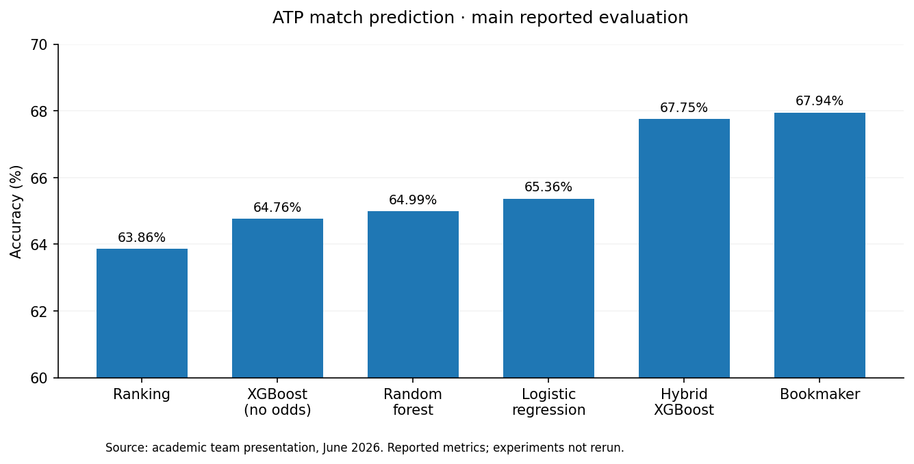
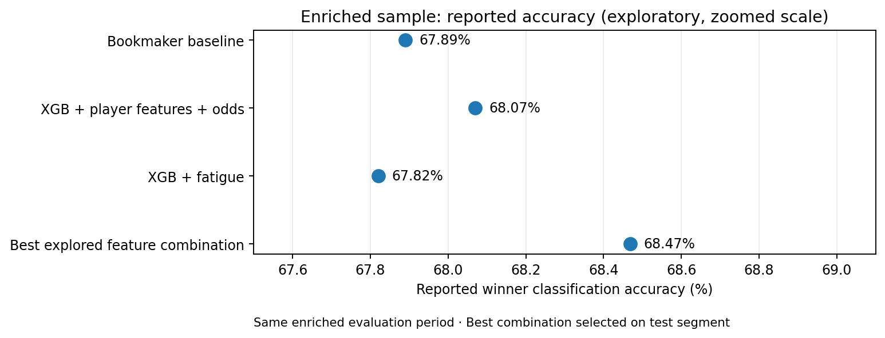
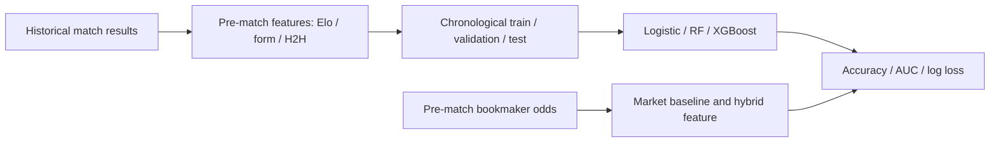

# ATP Tennis Match Prediction — Data Science & ML Engineering

**Academic team project · ML research + public code demonstration**  
**Stack:** Python · pandas · NumPy · scikit-learn · XGBoost · Jupyter · pytest

> Can pre-match rankings, Elo ratings, form, head-to-head and bookmaker-implied probabilities predict ATP winners—and are those probabilities *well calibrated*?

We investigated supervised learning for **ATP tennis match outcomes**, including chronological feature engineering and comparisons to bookmaker baselines. This repository deliberately distinguishes our **original academic research results** from a newer **reviewable, leakage-aware code demonstrator**.

## 1 · Headline findings from the final team study (June 2026)

**Our final enriched XGBoost model reached 68.468% reported accuracy**, compared with **67.89% for the bookmaker favorite on the same enriched evaluation period**: **+0.58 percentage points**. This is a meaningful *exploratory result*, but **not an independently validated claim of beating the betting market**. Read the limitations below.

### Stage A — Primary benchmark (48,986-match modeling sample)

The first comparative study used pre-match match-level features, dynamic Elo/form/H2H, and market odds. Its reported held-out comparison was:

| Method | Accuracy | ROC-AUC | Log loss |
| --- | ---: | ---: | ---: |
| Ranking baseline | 63.86% | — | — |
| Logistic regression | 65.36% | 0.7179 | 0.6136 |
| Random forest | 64.99% | 0.7138 | 0.6160 |
| XGBoost (sports features) | 64.76% | 0.7150 | 0.6150 |
| XGBoost + bookmaker probability | 67.75% | 0.7490 | 0.5887 |
| **Bookmaker favorite** | **67.94%** | **0.7510** | **0.5880** |



At this stage, the hybrid model was **0.19 percentage points behind** the bookmaker on accuracy. However, it established a strong foundation for richer feature engineering and the market remained the strongest comparator in probability-based metrics.

### Stage B — Final enrichment with player attributes (35,438-match merged sample)

The team merged match histories with an additional player-level dataset associated with **Jeff Sackmann** (1,482 player profiles, 64 columns). Integrating the datasets required **player-name harmonization**, dealing with missingness, and trading sample size for additional features. The enriched study included age, height, handedness and past-career descriptors, and explored fatigue proxies.

| Enriched-model comparison | Accuracy | F1 | ROC-AUC | Log loss |
| --- | ---: | ---: | ---: | ---: |
| XGBoost + additional player features, **without odds** | 65.27% | 65.48% | 0.7196 | 0.6119 |
| **Bookmaker favorite — same enriched period** | **67.89%** | — | — | — |
| XGBoost + player features **and odds** | 68.07% | 67.36% | 0.7514 | 0.5855 |
| XGBoost + fatigue features | 67.82% | 67.16% | 0.7506 | 0.5872 |
| **Best explored feature combination + odds** | **68.47%** | **67.71%** | **0.7498** | **0.5848** |



The highest-scoring exploratory combination added **age difference, height difference, career-best ranking difference and left-handedness** to core pre-match features and bookmaker probability. **The 68.468% reported accuracy is +0.578 percentage points over the same-period bookmaker baseline (67.89%).** These are the **team's historical reported metrics**, not rerun scores from `src/atp_ml/`.

**Important methodological caveats:**

- **Feature-selection bias:** the historical notebook's final exhaustive feature search ranks combinations directly on the same nominal test segment. Its best observed score is therefore *optimistically selected*; it must not be described as an untouched hold-out performance. A new separate test period would be needed for that claim.
- **Availability of auxiliary features:** some player-profile or career summaries may contain information not available as of each historical match date. Their exact as-of provenance should be audited before claiming a leak-free, deployable forecasting pipeline.
- **No claim of betting profitability:** the hybrid model *uses bookmaker odds as inputs*. Marginally exceeding a single bookmaker's winner-classification baseline **does not demonstrate better probabilities, economic returns, or sustained market outperformance**.
- **Different cohorts:** the primary and enriched comparisons use different data coverage. Compare each method against its **own period-matched bookmaker baseline**, not against the bookmaker score from the other stage.

**Source:** Team final presentation, *Predicting ATP Tennis Match Outcomes Using Machine Learning*, 26 June 2026, slides 11 and 14–20. For a fuller explanation of the feature-search issue, see [`docs/TEAM_RESULTS_AND_VALIDATION.md`](docs/TEAM_RESULTS_AND_VALIDATION.md) and [`docs/CODE_REVIEW_AND_LIMITATIONS.md`](docs/CODE_REVIEW_AND_LIMITATIONS.md).

## 2 · What we engineered

The core study built information *available before the match* rather than using the winner or score as model inputs:

- **Player strength:** ATP rank, rank points, global Elo and surface-specific Elo.
- **Recent momentum:** rolling win rates over recent matches.
- **Match-up history:** head-to-head results from earlier meetings.
- **Context:** court type, surface, tournament series and best-of format.
- **Market signal (separate hybrid model):** normalized implied win probability from bookmaker odds, removing overround.



## 3 · Code worth reviewing

Rather than expose only a long notebook, we extracted and **refactored** the most instructive parts into testable modules:

| File | What it demonstrates |
| --- | --- |
| [`src/atp_ml/features.py`](src/atp_ml/features.py) | Historical Elo, surface Elo, form and H2H, with updates **after** feature snapshots; same-date batching to limit look-ahead |
| [`src/atp_ml/train.py`](src/atp_ml/train.py) | **Separate chronological train, validation and held-out test** periods; preprocessing fit on train only; transparent bookmaker baseline |
| [`tests/test_features.py`](tests/test_features.py) | Behavioral unit tests, including same-date safety and no future-target use in features |
| [`notebooks/atp_match_prediction.ipynb`](notebooks/atp_match_prediction.ipynb) | Original team's explorations, experiment extensions and interpretation (archival notebook) |
| [`docs/CODE_REVIEW_AND_LIMITATIONS.md`](docs/CODE_REVIEW_AND_LIMITATIONS.md) | Detailed audit of what worked, what was corrected, and what still limits conclusions |

### Why the clean benchmark differs from the historical notebook

The original notebook correctly introduced chronological splitting but also performed a **later exhaustive feature search on the test set**. This makes the feature-search winner optimistically biased. The clean demonstrator instead chooses among models on a **validation window**, and touches the held-out test only once. It also avoids merging auxiliary aggregate player stats without confirming their **as-of timing**.

**These changes improve the code-review story but do not reproduce the original reported metrics.** Any newly measured scores belong to a distinct evaluation protocol and should be labeled accordingly.

## 4 · Run the public code demonstration

There is **no third-party CSV bundled** because redistribution rights and exact dataset version were not established. For local execution, supply your lawfully obtained `atp_tennis.csv`, which must contain the match-level columns described in [`data/README.md`](data/README.md).

```bash
python -m venv .venv
source .venv/bin/activate
pip install -e '.[dev]'
pytest -q
python -m atp_ml.train --csv /path/to/atp_tennis.csv --out outputs/metrics.json
```

The test suite uses **synthetic match rows**, so `pytest` can run without the external dataset. The benchmark requires the CSV and computing time. The refactored script was **smoke-tested locally** on the supplied historical match CSV, but its fresh test metrics are intentionally **not substituted for** the original team-study results (different evaluation protocol).

## 5 · Evaluation and limitations

We evaluated **accuracy, F1, ROC-AUC, log loss**, probability calibration and model-vs-market disagreements. However:

1. **Tennis is time-dependent.** Match records have calendar dates without exact start times. Our refactor prevents outcomes of same-date matches from affecting each other's pre-match features.
2. **Market information is strong.** A model incorporating bookmaker odds should be evaluated against the bookmaker itself, not just a naive ranking baseline.
3. **Auxiliary career/season aggregates can leak the future.** We did not include unverified as-of player statistics in the reproducible core.
4. **Feature selection requires a validation period.** The original exhaustive feature-search results are exploratory, not independent-test claims.
5. **Calibration is not guaranteed by ranking ability.** A good accuracy score need not imply trustworthy probabilities.

See the [full code review and reproducibility notes](docs/CODE_REVIEW_AND_LIMITATIONS.md).

## Credits & scope

**Group academic project** (Matthieu, Raphaël, Roslane, Quentin and Hugo, as listed in the supplied group materials). The source notebook and experiment results represent joint work. The `src/` modules are a separate portfolio refactor grounded in the team's methods; they are not presented as the exact scripts used in the original study or as sole-authored original research.

**This repository demonstrates research reasoning and software quality; it does not offer gambling advice or a trading strategy.**
